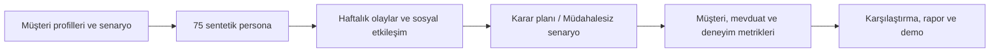
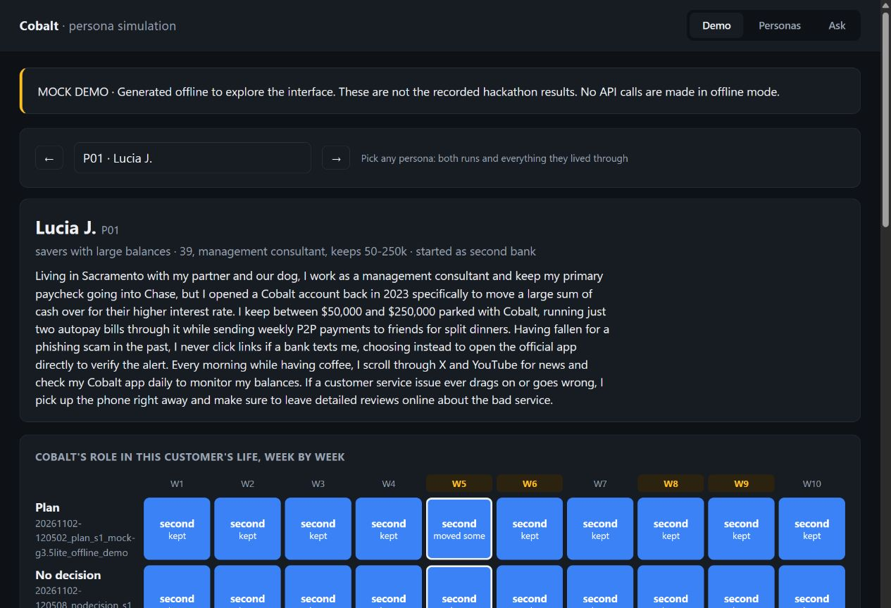

# Cobalt Bank — Müşteri Davranışı Simülasyonu

[](https://github.com/EminOral3/simulation-hackathon/actions/workflows/tests.yml)

TALP Simulation Hackathon için üç kişilik ekibimizle geliştirdiğimiz proje. Cobalt Bank senaryosunda, bir bankacılık sistemi geçişi ve beklenmedik krizler sırasında müşterilerin nasıl davranabileceğini simüle ettik.

Amacımız, bankanın alacağı kararların müşteri kaybı, mevduat ve müşteri deneyimi üzerindeki olası etkilerini karşılaştırmaktı.

**75 persona · 10 hafta · 2 karar · 4 milyon dolar senaryo bütçesi**

[Yöntem](docs/submission/TEAM_DOC.md) · [Sonuç raporu](docs/submission/CLIENT_MEMO.md) · [Sunum](Cobalt_kurul_sunumu_v2.pptx)

## Ne yaptık?

- Farklı müşteri gruplarını temsil eden 75 sentetik persona oluşturduk.
- Müşterilerin haberlerden, banka mesajlarından ve birbirlerinden etkilenmesini 10 haftalık bir simülasyonda modelledik.
- İletişim, destek kapasitesi ve finansal teşvikler içeren kararları, hiçbir müdahale yapılmayan senaryoyla karşılaştırdık.
- Deney sonuçlarını analiz edip yönetim kurulu raporu, sunum ve persona davranışlarını inceleyen bir web demosu hazırladık.

Python tabanlı projede LLM destekli ajanlar, davranış modelleme, kuyruk hesaplamaları ve istatistiksel analiz birlikte kullanılıyor.





*API anahtarı gerektirmeyen mock demo. Hackathonda teslim edilen LLM koşularından ayrı olarak üretilmiştir.*

## Ne elde ettik?

Hackathon teslim raporundaki iki tekrarın sonuçları:

| Metrik | Karar planımız | Müdahalesiz senaryo |
|---|---|---|
| Mevduatın korunması | %89,8 / %90,8 | %85,5 / %86,5 |
| Aktif müşterilerin korunması | %98,9 / %94,3 | %96,7 / %94,9 |
| App Store puanı | 4,52 / 4,50 | 4,47 / 4,48 |
| Kullanılan senaryo bütçesi | 3,6 milyon dolar | 0 |

Planımız iki koşuda da yaklaşık **4–5 yüzde puan daha fazla mevduatın korunmasını** sağladı. Müşteri koruma hedefi her koşuda sağlanmadı; az sayıda tekrar ve model seçimi sonuçları etkiliyor. CFPB şikâyetleri güvenilir biçimde ölçülemeyecek kadar seyrek kaldı.

Bu tablo [teslim raporunun](docs/submission/CLIENT_MEMO.md) arşividir. Sonradan yapılan [metrik v2 incelemesi](code_kit/cobalt/outputs/reports/20261024_metrics_v2_recalculation_930cb3a/README.md), aktif müşteri ölçümünün gerçek uygulama kullanımını değil bir ilişki durumu göstergesini temsil ettiğini açıklar. Simülasyon sonuçlarını gerçek müşterilerle doğrulanmış etki olarak yorumlamıyoruz.

## Lokalde çalıştırma

Python 3.11 veya üzeri ile, proje klasöründe:

```powershell
python -m venv .venv
.\.venv\Scripts\python.exe -m pip install -r code_kit/requirements.txt
```

**Demoyu aç:** API anahtarı olmadan, teslim edilen kararları ve müdahalesiz senaryoyu mock modunda çalıştırır; ardından web arayüzünü başlatır.

```powershell
.\.venv\Scripts\python.exe -X utf8 tools/prepare_demo.py --serve
```

Tarayıcıda <http://localhost:8765> adresini açın. Persona seçip haftalık olaylarını ve iki senaryodaki davranışlarını karşılaştırın; **Ask** sekmesinde kayıtlarına dayanan çevrimdışı cevapları inceleyin. Durdurmak için terminalde `Ctrl+C` kullanın.

Demo çıktıları `code_kit/cobalt/outputs/demo/` altında tutulur; arşivlenmiş deneyleri değiştirmez. Arayüzdeki **MOCK DEMO** etiketi bu yeni kayıtları hackathon sonuçlarından ayırır. Mock modu gerçek LLM deneylerini yeniden üretmez.

macOS/Linux için kurulum ve demo komutları:

```powershell
python3 -m venv .venv
.venv/bin/python -m pip install -r code_kit/requirements.txt
.venv/bin/python -X utf8 tools/prepare_demo.py --serve
```

Canlı Gemini koşuları için `--live`, uygun API erişimi ve `TALP_KEY` veya `VERTEX_AI_KEY` gerekir. Model ayarları ve ek araçlar için [teknik notlara](code_kit/README.md) bakın. Anahtarları Git'e eklemeyin. Eski teslim koşularının tam kayıtları repoda bulunmadığı için demo yeni mock kayıtları üretir.

Mevcut çevrimdışı testleri çalıştırmak için:

```powershell
.\.venv\Scripts\python.exe -X utf8 -m pytest -q code_kit/tests code_kit/cobalt/tests
```

## Dosyalar

- [`code_kit/cobalt/`](code_kit/cobalt/): Simülasyon motoru, personalar, deneyler ve metrikler.
- [`tools/`](tools/): Web demosu ve persona soru-cevap araçları.
- [`docs/submission/TEAM_DOC.md`](docs/submission/TEAM_DOC.md): Yöntem ve deneylerin açıklaması.
- [`docs/submission/CLIENT_MEMO.md`](docs/submission/CLIENT_MEMO.md): Kararlar ve sonuçların kısa raporu.
- [`code_kit/README.md`](code_kit/README.md): Genel simülasyon modüllerinin teknik notları.

## Ekip

Emin Oral · Gürkan Türker · Süleyman Tolga Acar

- **Emin:** Veri bilimi, validasyon, risk ve davranış modelleme.
- **Gürkan:** Ayrık olay simülasyonu, senaryolar, ROI ve sunum.
- **Tolga:** LLM entegrasyonu, backend ve canlı demo.

Bu repo, [ortak proje deposunun](https://github.com/SuleymanTolgaAcar/simulation-hackathon) commit geçmişini koruyan bir kopyasıdır.

> Personalar sentetiktir; gerçek Cobalt müşteri verisi kullanılmadı. Sonuçlar model ve varsayımlara bağlıdır, gerçek müşteri davranışının doğrulanmış tahminleri değildir.
